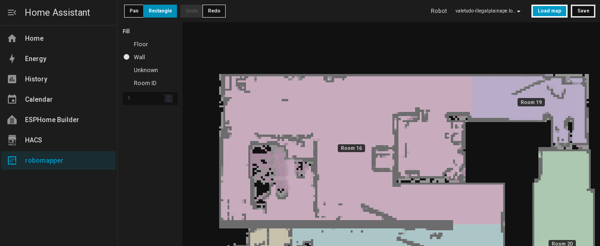

# robomapper

Edit a robot vacuum's occupancy map and room IDs from Home Assistant.



## Features

- Paint floor, walls, and unknown areas.
- Assign room IDs.
- Undo and redo map edits.
- Load maps from the robot and save changes back.
- Back up maps before saving.

Supported robots:

- Roborock S7 running firmware `4.3.5_1612`.

## Install

Requires Home Assistant 2026.10 or later and SSH access to the robot.

1. Add `https://github.com/flaviut/robomapper` as a HACS custom repository, category **Integration**.
2. Download **robomapper** and restart Home Assistant.
3. Under **Settings → Devices & services → Add integration**, select **robomapper** and enter the robot's address.
4. Run the SSH command shown during setup, then submit. The integration generates its own ED25519 key; the command authorizes it on the robot.

Open **robomapper** in the sidebar, select your robot and choose **Load map**. Edit the map, then choose **Save** to install the changes and restart the robot.

Backups are stored in `<HA config>/map_editor/backups/`. For manual recovery, use the [restore guide](docs/guides/matching-set-restore.md).

## Develop

Requires Nix with flakes. The development shell provides Node.js and pnpm.

```sh
git clone https://github.com/flaviut/robomapper.git
cd robomapper/map-editor
nix develop
pnpm install --frozen-lockfile
pnpm build:hass
pnpm test
pnpm test:ui
```

Browser tests require Chromium on `PATH` or at `CHROMIUM_PATH`. For the standalone development server, see [map-editor/README.md](map-editor/README.md).

Run backend tests from the repository root with Python 3.14:

```sh
python3.14 -m venv .venv
.venv/bin/pip install -r tests/requirements.txt
.venv/bin/python -m unittest discover -s tests -v
```
