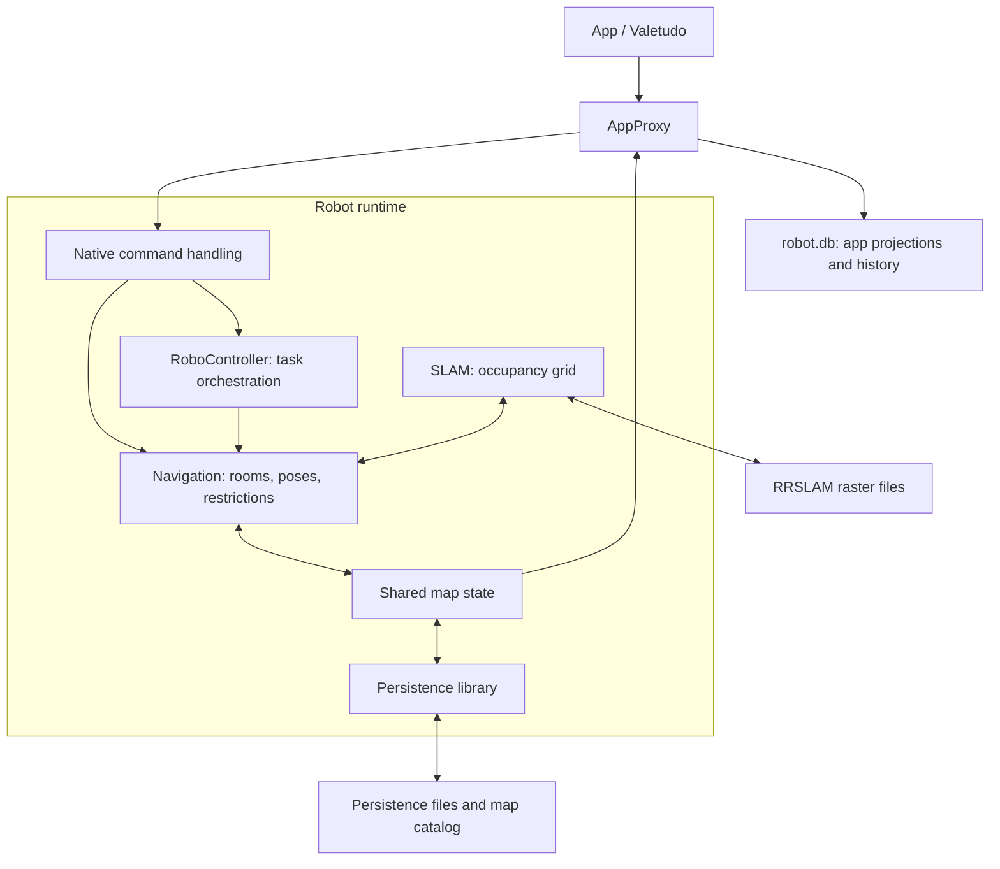
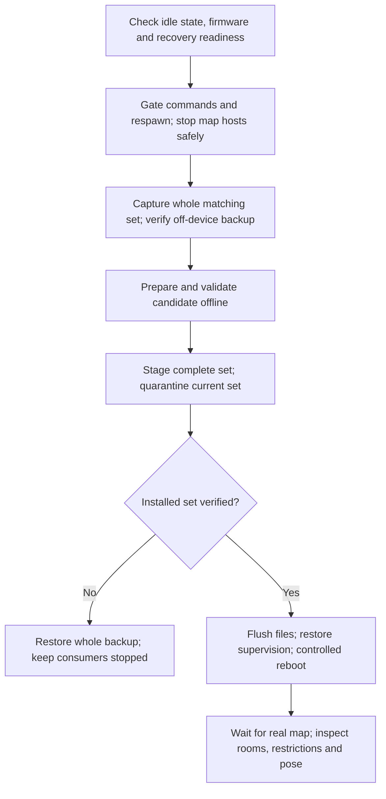

# Robot map subsystem

High-level summary of the S7 firmware `4.3.5_1612` [research docs](../docs/README.md).

## Architecture

A saved map is a **matching set**, not a single image. Occupancy, room labels,
restrictions, map selection and application previews live separately.

Navigation, SLAM and chassis share the `rr_loader` host. The diagram shows
responsibilities, not every IPC route.

- **Raster:** `last_map` and `user_map*` hold occupancy/confidence cells.
- **Persistence:** `PersistData_*` holds room labels, names, restrictions, poses
  and opaque state. `SharedMultiMapInfo` selects primary/backup associations.
- **Companions:** navigation config, pose files and `robot.db` with its existing
  SQLite sidecars belong to the same snapshot. App previews are not native maps.

See [storage](../docs/reference/maps/storage.md) and the
[matching-set contract](../docs/reference/maps/matching-set.md).

## Map update procedure

The documented offline path replaces a stopped matching set, then cold-starts
the robot. **Unchanged restoration has passed; edited-map import remains
untested in these research docs.** This is an overview, not a device runbook.

The maintenance window must preserve Linux watchdog feeding and MCU safety;
stopping `rr_loader` also stops chassis. Follow the
[stop/backup guide](../docs/guides/stopped-backup.md) and
[whole-set restore guide](../docs/guides/matching-set-restore.md).

For the bounded [raster-edit candidate](../docs/guides/raster-edit.md), change
only a small occupancy patch and its digest. Preserve the coordinate frame,
topology, persistence, companions and genuine backup. Use ordinary native
split/merge/rename operations for room changes, refreshing IDs afterward;
loading a raster does not establish automatic room regeneration.

Do not replace live files or force a load/recover/save afterward: buffered state
can override disk, and recovery can copy an older backup over the replacement.
Saves are asynchronous and not transactional across files. A real reboot clears
old shared-memory buffers, but startup may read both runtime and selected primary
slots. See [persistence](../docs/reference/maps/persistence.md) and
[startup selection](../docs/reference/maps/startup.md).
